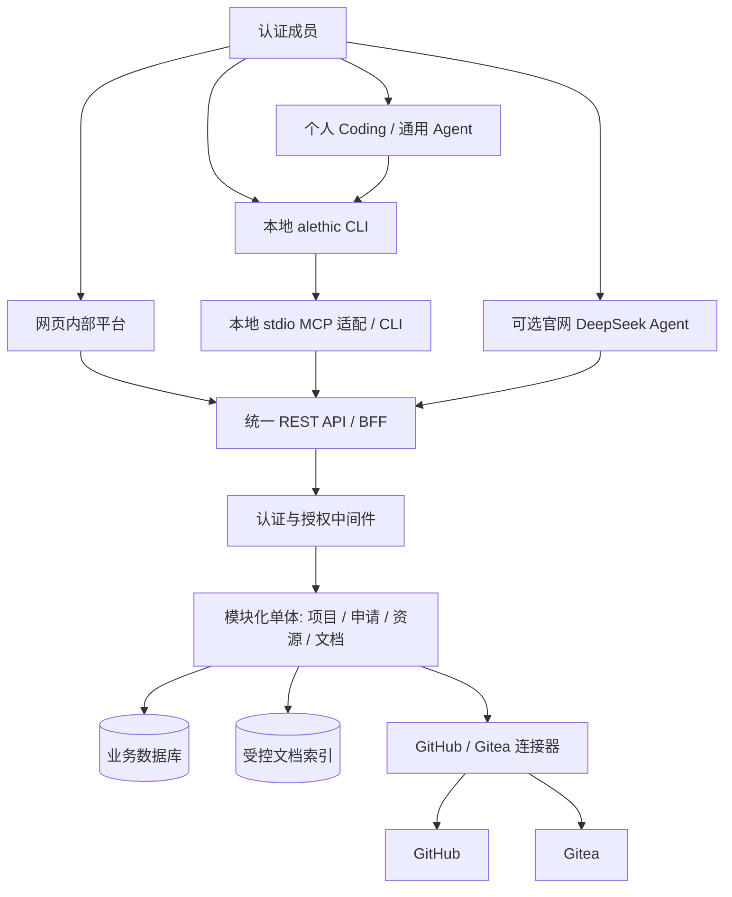

# 02 · 架构、事实来源与解耦边界

## 逻辑结构

**部署不必等于逻辑分层。** 在 4GB 小主机上优先采用少数进程 + 一套关系型数据库 + 本地 CLI。尽量避免 Kubernetes、多服务网格、复杂队列、独立向量数据库。可在同一代码仓库下模块隔离。

## 四层边界

1. **入口层**（Web、CLI、个人 Agent、可选官网 Agent）负责 UI/对话，不拥有业务规则。
2. **适配层**（REST SDK、本地 MCP、Skill）负责将操作映射到稳定业务接口，不直接访问数据库。
3. **业务层**（成员、文档、项目、申请、资源）执行状态机、校验、审计、授权。
4. **数据/集成层**（业务数据库、版本化文档、GitHub、Gitea）分别维护各自的事实。

## 事实权威与禁止双写

| 信息 | 唯一权威位置 | 不该做的事 |
|---|---|---|
| 正式章程/组织规则 | governance-public 或另行指定的正式制度仓 | AI 在对话里改写规定 |
| 公开学习/技术指导 | open-onboarding / awesome-ai | 把课程进度当作组织权限 |
| 成员资格/项目归属 | 已确定的成员目录与平台业务 DB（需先核实） | CLI 和网页独立维护成员表 |
| 申请、审批、生命周期状态 | 平台业务 DB | 用 GitHub Issue 标题猜最终状态 |
| Git 代码/分支/提交/PR | 每仓唯一指定 GitHub 或 Gitea 主仓 | 两端同时接受写入并试图自动合并 |
| GitHub/Gitea 同步情况 | 集成器缓存 + `last_synced_at` | 断网时标记实时状态 |

## 三层上下文发现（适用于自有 Agent，也适用于个人 Agent）

- **L1：薄的入口说明**。核心定位、可用能力目录、如何登录和发现 Skill；常驻内容尽量短。
- **L2：按需 Skill**。根据查询/申请场景读取相关工具、来源链接、输入/输出规则。
- **L3：特定文档与业务数据**。根据主体和请求动态读取带 source_id、revision、updated_at、visibility 等 metadata 的内容。

这是**降低上下文与维护成本**的方式；L1/L2 文本不是授权。所有 L3 数据与写操作均由服务端按用户、客户端、资源、动作检查。

## 高可用性不等于组件更多

- API/数据库故障：CLI、Web、Agent 都可能受影响；因此需要备份、恢复预案和状态页。
- 模型故障：只影响自然语言体验，Web 和 CLI 不应失效。
- GitHub 故障：只影响仓库即时信息、镜像，申请状态仍可查询。
- Gitea 故障：如果是内部代码主仓，代码服务受影响；组织业务 DB 应尽量可独立运行。
- 文档索引故障：优先提供清晰提示和原文链接；不要生成无来源的制度答复。
- 单机停电/磁盘损坏：整个平台可能离线；可靠备份比多实例进程更优先。

## 推荐边界

- `api`/`services`/`repositories`/`adapters` 在代码内解耦。
- `contracts/openapi-skeleton.yaml` 是初版协议起点；正式契约由服务端生成或经契约测试比对。
- 将 HTTP 客户端、CLI、MCP 均指向同一个 SDK/REST 接口；禁止客户端绕过 API 去读本地数据库。
- API 版本 `/api/v1`；破坏兼容时升级主版本或引入兼容迁移。

## 对外开放的含义

API 可以拥有互联网可到达的 HTTPS 域名，**但受保护的资源仅对具备成员资格和令牌作用域的请求开放**。不得把“公开 URL”误解成“匿名可读取内部数据”。如果学校网络/域名/证书约束不允许可靠外网访问，可退回 VPN/私有网络方式；这是部署选项而不是产品逻辑差别。
